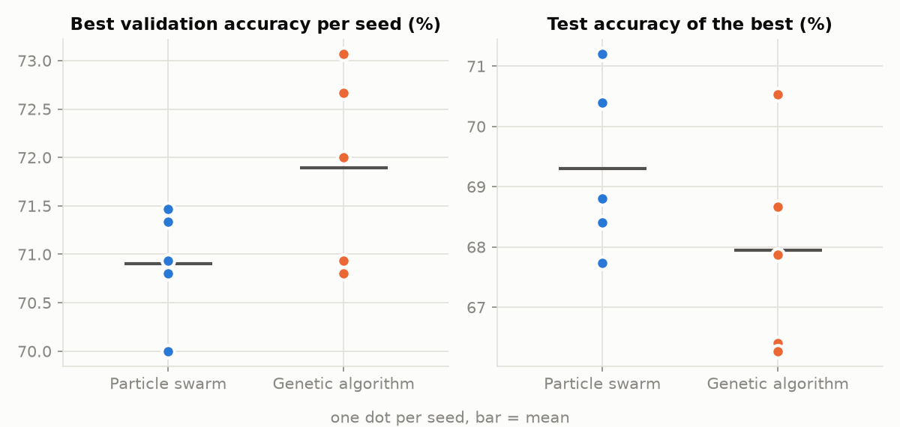
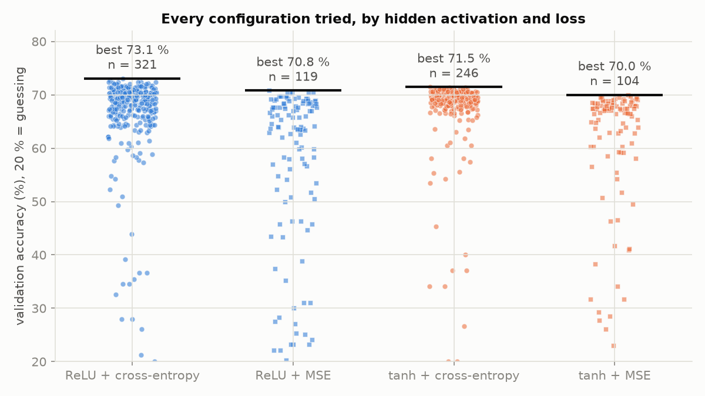
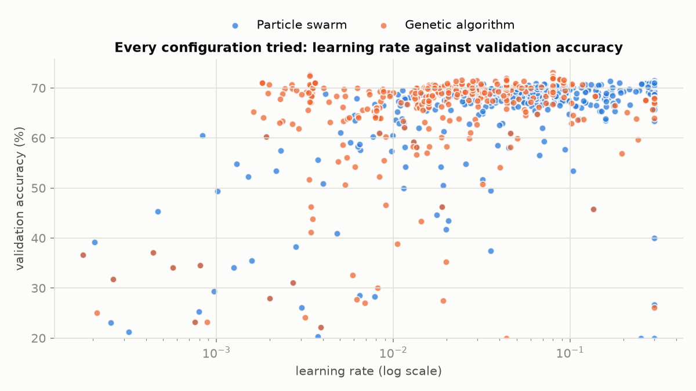
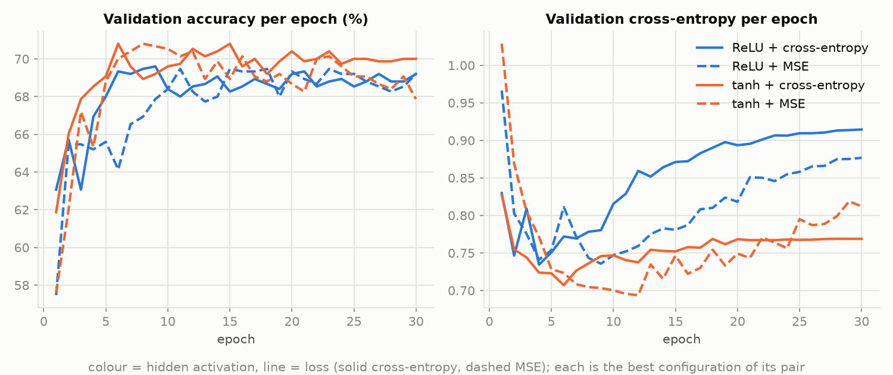
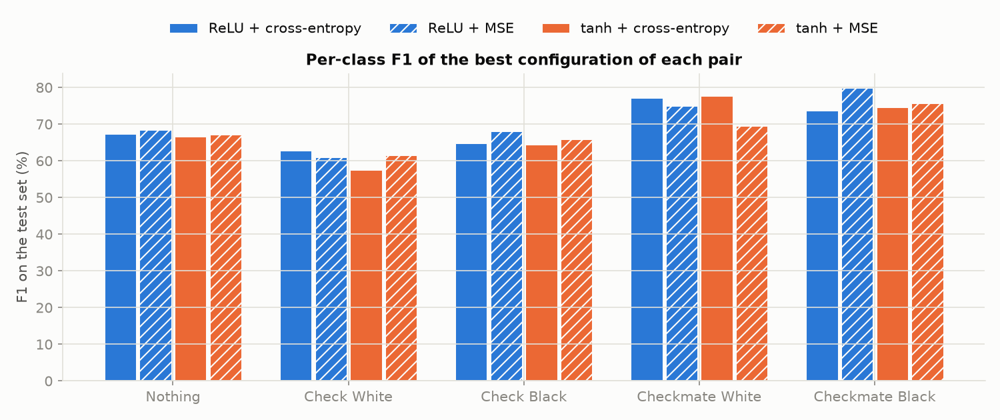

# Hyperparameter search: what we tried, what we found, what we chose

One benchmark tests every configuration we considered: two search methods (particle swarm and a genetic algorithm)
look through 8 hyperparameters at once, **including the hidden activation and the loss**, on real chess positions.
This page gives its results, its plots and the choices they led to.

1. [The chosen configuration](#1-the-chosen-configuration)
2. [What is searched](#2-what-is-searched)
3. [How a configuration is scored](#3-how-a-configuration-is-scored)
4. [The two search methods](#4-the-two-search-methods)
5. [Benchmark setup](#5-benchmark-setup)
6. [Results](#6-results)
7. [Why we chose what we chose](#7-why-we-chose-what-we-chose)
8. [From the search to the network we push](#8-from-the-search-to-the-network-we-push)
9. [Limits](#9-limits)
10. [Reproducing it](#10-reproducing-it)

## 1. The chosen configuration

> **The network we push is not this one.** The search identified what matters (method, loss, activation, depth,
> learning rate); on top of it we added early stopping, dropout and L2, which a small-scale search cannot judge, and
> that network wins at full scale: see [§8](#8-from-the-search-to-the-network-we-push). 2 × 47 remains the default
> training of a network saved without one.

| Choice | Value | Why, in one line (details in [§7](#7-why-we-chose-what-we-chose)) |
|---|---|---|
| Search method | **particle swarm** | its best configurations generalise better to boards the search never saw |
| Loss | **cross-entropy** | MSE fails 4 to 6 times as often and gives about half as many good networks |
| Hidden activation | **ReLU** | ties with tanh on accuracy, has the best top configurations and is cheaper |
| Output activation | **softmax** | turns the scores into one probability per class, the only sensible output for 5 exclusive classes |
| Network | **769 → 47 ReLU → 47 ReLU → 5 softmax** | the search keeps landing on 1 or 2 hidden layers; none of the new results is significantly better than this one |
| Training | Momentum, learning rate 0.018, momentum 0.53, batches of 9, learning rate × 0.86 per epoch, **early stopping** | the learning curves peak after 6 to 11 epochs, then the validation loss rises |

This is the engine's default training (`my_torch/src/engine/engine.cpp`) and
[`configs/basic_network.conf`](../configs/basic_network.conf), the config `my_torch_generator` builds blank networks from.

## 2. What is searched

| Hyperparameter | Range | Scale | Why |
|---|---|---|---|
| `learning_rate` | 1e-4 to 0.3 | logarithmic | the step size of Momentum; useful values span several orders of magnitude |
| `momentum` | 0 to 0.99 | linear | how much of the previous step is kept |
| `batch_size` | 8 to 128 | logarithmic, whole | boards per gradient step |
| `hidden_size` | 16 to 256 | logarithmic, whole | neurons per hidden layer |
| `hidden_layers` | 1 to 3 | whole | hidden layers before the softmax output |
| `decay` | 0.8 to 1 | linear | the learning rate is multiplied by it every epoch (1 keeps it) |
| `activation` | ReLU or tanh | choice | the activation of every hidden layer |
| `loss` | cross-entropy or MSE | choice | what training minimises |

The library has exactly the activations and losses that make sense for this problem: **ReLU** and **tanh** as
hidden-layer candidates, **softmax** for the output, and the two losses **cross-entropy** and **mean squared error**.

Both methods work in the unit cube $`[0, 1]^8`$, one coordinate per hyperparameter, and `SearchSpace::decode` maps a
point to values: $`low + u\,(high - low)`$ on a linear scale, the same between $`\log(low)`$ and $`\log(high)`$ on a log
scale, rounding for whole values, and for a choice between $`n`$ options $`[0, 1]`$ is cut into $`n`$ equal slices.
So the activation and the loss are **just two more dimensions**: the methods move through them like any other.
Code: `my_torch/src/training/hyperparameters/search_space/`.

## 3. How a configuration is scored

`ValidationLoss` builds the network a configuration describes (769 inputs, `hidden_layers` × `hidden_size` hidden
neurons with the chosen activation, 5 softmax outputs), trains it for 6 epochs on the training split with Momentum,
the chosen loss and the exponential decay, then `ValidationError` returns its **validation error**: the share of the
750 validation boards it gets wrong, boards it never trained on.

- **Why accuracy and not the loss:** the loss itself is one of the choices. Scoring by validation cross-entropy would
  favour networks trained with cross-entropy; accuracy is fair whatever a network was trained with, and it is what
  `--predict` is judged on.
- **Why held-out boards:** a configuration that only memorises its training boards scores badly, so the search is
  steered away from overfitting.
- Every configuration trains from the same seed, so two configurations are compared on equal terms. A training that
  diverges gets the worst possible score.

Code: `my_torch/src/training/hyperparameters/validation_loss/`.

## 4. The two search methods

Both minimise the same score over the same space and log every evaluation. Code:
`my_torch/src/training/hyperparameters/algorithms/`.

### Particle swarm optimization (PSO)

Each particle is a configuration with a position $`x`$ and a velocity $`v`$. It remembers the best position it has
found, $`p`$, and the swarm shares the best position anyone has found, $`g`$. At every iteration, for each
coordinate, with $`r_1, r_2`$ drawn uniformly in $`[0, 1]`$:

```math
v \leftarrow w\,v + c_1 r_1 (p - x) + c_2 r_2 (g - x), \qquad x \leftarrow x + v
```

| Setting | Value | Role |
|---|---|---|
| inertia $`w`$ | 0.7 | keeps part of the previous move: exploration |
| cognitive $`c_1`$ | 1.5 | pull towards the particle's own best |
| social $`c_2`$ | 1.5 | pull towards the swarm's best |
| max velocity | 0.2 | a particle never crosses more than 20 % of a range in one step |

A particle that hits a bound stays on it and loses its velocity along that coordinate.

### Genetic algorithm (GA)

A population of configurations evolves over generations. Each generation keeps its best individual unchanged (an
elite, not trained again), then fills the rest with children:

- **selection**: each parent is the best of 3 individuals drawn at random (tournament);
- **crossover** (90 % of children): each gene is drawn between and slightly beyond the parents' genes, $`a + u\,(b - a)`$
  with $`u`$ uniform in $`[-0.25, 1.25]`$ (blend crossover);
- **mutation**: each gene moves by a Gaussian step of standard deviation 0.1 with probability 0.2.

## 5. Benchmark setup

| | |
|---|---|
| Data | 7,500 positions from the Lichess database of January 2013, balanced over the 5 classes: 6,000 train, 750 validation, 750 test (`python -m dataset.generate ... --per-class 1500`) |
| Inputs | the analyzer's 769-input encoding (`analyzer.encoder.encode_fen`) |
| Training per evaluation | 6 epochs, scored by validation error |
| Budget | PSO: 8 particles × 10 positions = **80** networks; GA: 8 individuals + 10 generations × 7 children = **78** networks |
| Repetitions | 5 seeds per method, the 10 searches run in parallel: **790 networks** in all |
| Learning curves | the best configuration of each activation and loss pair, over all 10 searches, retrained for 30 epochs and measured after every epoch |
| Final check | test metrics on the **test** split, never used by the search |

## 6. Results

### The two methods

| Method | Best validation accuracy | Test accuracy | Networks trained to reach 70.0 % | Minutes per search |
|---|---|---|---|---|
| Particle swarm | 70.9 ± 0.6 % | **69.3 ± 1.4 %** | 28.8 ± 13.5 | 29.3 ± 7.5 |
| Genetic algorithm | **71.9 ± 1.0 %** | 67.9 ± 1.8 % | **18.2 ± 9.6** | **25.4 ± 8.7** |

Mean ± standard deviation over 5 seeds; 70.0 % is the lowest final score of the 10 searches, a level every search
reaches. Guessing among the 5 classes would give 20 %.




The genetic algorithm climbs faster and ends higher **on the validation boards it selects on**, but its best
configurations do **worse on the test boards** (67.9 % against 69.3 %). Selection keeps whatever scored best on the
same 750 validation boards, so part of what it finds is noise of those boards: it overfits the validation split.
The swarm's choices hold up better on unseen data. The first version of this benchmark (6 hyperparameters, scored by
validation loss, logs in commit `ac8678d`) found the same: equal validation quality, steadier test results for the swarm.

### Activations and losses

| Hidden activation + loss | Networks trained | Good (≥ 68 %) | Failed (< 50 %) | Median | Best |
|---|---|---|---|---|---|
| ReLU + cross-entropy | 321 | 61 % | 4 % | 68.9 % | **73.1 %** |
| ReLU + MSE | 119 | 28 % | 23 % | 63.9 % | 70.8 % |
| tanh + cross-entropy | 246 | **77 %** | 4 % | **69.2 %** | 71.5 % |
| tanh + MSE | 104 | 32 % | 14 % | 67.0 % | 70.0 % |



- **The loss matters, the activation barely.** With MSE, 4 to 6 times as many configurations fail and only half as
  many are good. Both methods noticed: they spent 72 % of their 790 networks on cross-entropy.
- **ReLU and tanh tie.** ReLU has the best configurations (73.1 %, top-10 mean 72.4 % against 71.2 %), tanh is more
  forgiving (77 % of its configurations are good against 61 %).



Learning rates below 1e-3 fail in 6 epochs (too slow to learn anything), and the good configurations sit between
about 0.005 and 0.3. The genetic algorithm concentrates there quickly; the swarm keeps exploring more widely.

### Learning curves

The best configuration of each pair, retrained for 30 epochs and measured after every epoch:



| Hidden activation + loss | Found by | Best epoch | Validation accuracy | Test accuracy | Test macro-F1 |
|---|---|---|---|---|---|
| ReLU + cross-entropy | GA seed 2 (1 × 134) | 9 | 69.6 % | 69.3 % | 69.2 % |
| ReLU + MSE | GA seed 1 (2 × 59) | 11 | 69.5 % | 70.8 % | 70.4 % |
| tanh + cross-entropy | PSO seed 4 (1 × 256) | 6 | 70.8 % | 68.7 % | 68.2 % |
| tanh + MSE | PSO seed 0 (2 × 68) | 8 | 70.8 % | 67.9 % | 67.9 % |

- **Accuracy levels off after 6 to 11 epochs** at 69–71 % for every pair: more epochs do not help.
- **The validation cross-entropy turns back up after about epoch 5**, most of all for ReLU + cross-entropy: the
  network grows more confident without getting more boards right. That is overfitting, and it is why training uses
  **early stopping** (stop when the validation loss has not improved for 5 epochs, keep the best weights).
- The validation loss is measured with cross-entropy for every pair, so the four curves share one scale; MSE-trained
  networks are scored on it too, not on their own training loss.
- On the test set, the four best configurations are within 3 points of each other: with 750 test boards, one board
  is 0.13 point and the noise is about ±1.7 point, so none is significantly better.



Every pair finds the **checkmates** easiest (F1 69–80 %) and **Check White** hardest (57–63 %). A check depends on
a line of attack across the board, which a dense layer only sees through many separate square inputs; checkmate
positions are also simpler boards, with about 15 pieces left on average against about 26 for "Nothing" (the dataset
generator's report).

## 7. Why we chose what we chose

**Particle swarm.** Final validation quality is close (70.9 against 71.9 %), and the genetic algorithm gets there
with fewer networks, but its best configurations do 1.4 points worse on unseen boards. In the first version of this
benchmark both methods tied on test accuracy, and the swarm's results were the steadier ones (test loss ± 0.001
against ± 0.023). What matters is the network we keep, judged on data the search never touched, so we keep the method whose
choices transfer. The swarm also has fewer settings to tune (inertia, two pull weights and a speed cap, against
population, elites, tournament size, crossover and mutation rates and mutation scale).

**Cross-entropy.** It is the clear winner of the benchmark, and theory says why: with softmax, its gradient on the
outputs is simply $`p - y`$, large when the network is confidently wrong, while MSE's gradient goes through the
softmax's slope and fades exactly when the network is most wrong. MSE can reach the same accuracy (ReLU + MSE's best
configuration even scores 70.8 % on test), but only in a narrow corner of the space: 23 % of ReLU + MSE configurations
fail. A loss that only works when everything else is tuned just right is a fragile default.

**ReLU.** The benchmark ties it with tanh on accuracy (best test accuracies 69.3 against 68.7 %, within the noise).
ReLU has the best top configurations and is cheaper to compute (one comparison, no exponential), which matters for
training on more boards. Its weakness, a validation loss that rises after a few epochs, is already handled by early
stopping keeping the best weights. tanh would be a sound alternative: more forgiving, but slightly lower at its best.

**Softmax** is not searched: the output must give one probability per class over 5 exclusive classes, which is
exactly what softmax does (and what cross-entropy expects).

**2 × 47 kept as the default.** The search keeps landing on 1 or 2 hidden layers of 50 to 250 neurons with learning
rates of 0.02 to 0.08, the region of the current default, and no new configuration is significantly better on the
test set. Keeping it means nothing changes for the analyzer, the engine or networks already trained.

## 8. From the search to the network we push

The search identified the parameters that matter: **cross-entropy** (by far the largest effect), **ReLU** hidden
layers (tanh is as good), **2 hidden layers**, and a learning rate in the 0.005 to 0.3 band with Momentum. What it
cannot judge is what only pays off over a full training on many boards: after 6 epochs on 6,000 boards, a network
has not yet had time to overfit, so regularisation has nothing to fix.

On top of what the search found, `configs/regularized_network.conf` adds the three guards against overfitting:

| Guard | Setting | What it does |
|---|---|---|
| **Early stopping** | 10 % of the boards kept aside, patience 8, best weights kept | stops once the validation loss no longer improves and keeps the best epoch |
| **Dropout** | 0.2 after each hidden layer | switches off 20 % of the neurons at random at every step, so the network cannot memorise boards through a few of them |
| **L2 (weight decay)** | 1e-4 | pulls every weight towards 0, so the network cannot fit the noise of the training boards with large weights |

With these guards the network can afford to be wider (128 then 64 neurons) without overfitting, and it trains with
Momentum 0.9, a learning rate of 0.01 halved every 10 epochs, and batches of 32.

Both configurations were then trained with `./my_torch_analyzer --train` on all 160,000 boards, 3 seeds each, and
judged on 20,000 validation boards neither trained on; the 20,000 test boards were only used to report
([`benchmarks/final_network/`](benchmarks/final_network/)):

| Config | Epochs (kept / run) | Validation accuracy | Test accuracy | Minutes per training |
|---|---|---|---|---|
| `basic_network.conf` (2 × 47, early stopping only) | 9 to 11 / 14 to 16 | 82.2 to 82.5 % | 82.5 to 82.7 % | 4 to 4.5 |
| `regularized_network.conf` (128 + 64, early stopping, dropout, L2) | 11 to 12 / 19 to 20 | **83.4 to 83.9 %** | **83.9 to 84.1 %** | 12 to 13 |

The regularized network wins on every seed, by about 1.4 points on the test boards, and is
`my_torch_network_full.nn`. Its second hidden layer uses tanh rather than ReLU; the search found the two equivalent.

## 9. Limits

- **Small scale:** 6 epochs per evaluation and 7,500 boards keep one search around half an hour. The final network
  trains longer, with early stopping, on more boards.
- **Noisy scores:** 750 validation boards make one board worth 0.13 point; differences under about 2 points are noise,
  which is why the choices above rest on medians, failure rates and both versions of the benchmark rather than on
  single best scores.
- **One run of 30 epochs per learning curve:** the curves show trends (plateau, rising validation loss), not exact
  epoch numbers.

## 10. Reproducing it

```bash
python -m dataset.generate lichess_db_standard_rated_2013-01.pgn --out data --per-class 1500
scripts/run_hyperparameter_benchmark.sh data docs/benchmarks/hyperparameter_search 6 5 30
python -m scripts.plot_hyperparameter_search docs/benchmarks/hyperparameter_search docs/images/hyperparameter_search
```

The first command builds the dataset; the second encodes it, builds the benchmark (`make -C my_torch benchmark`),
runs the 10 searches in parallel (about 40 minutes on 10 cores), then the learning curves; the third draws every
figure of this page and prints its tables. Every evaluation is logged in
[`docs/benchmarks/hyperparameter_search/`](benchmarks/hyperparameter_search/): `*_evaluations.csv` (one line per
network trained), `*_convergence.csv`, `summary.csv` (one line per search), `curves_*.csv` and `curves_summary.csv`.
