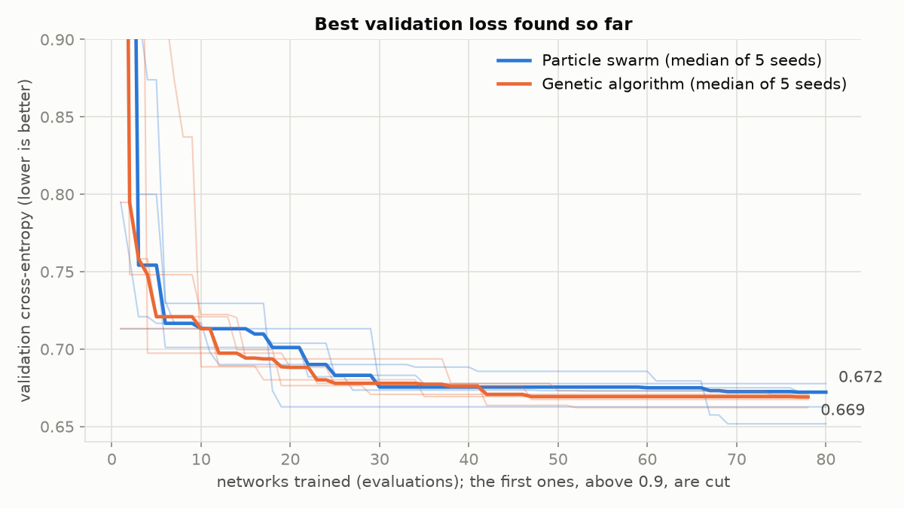
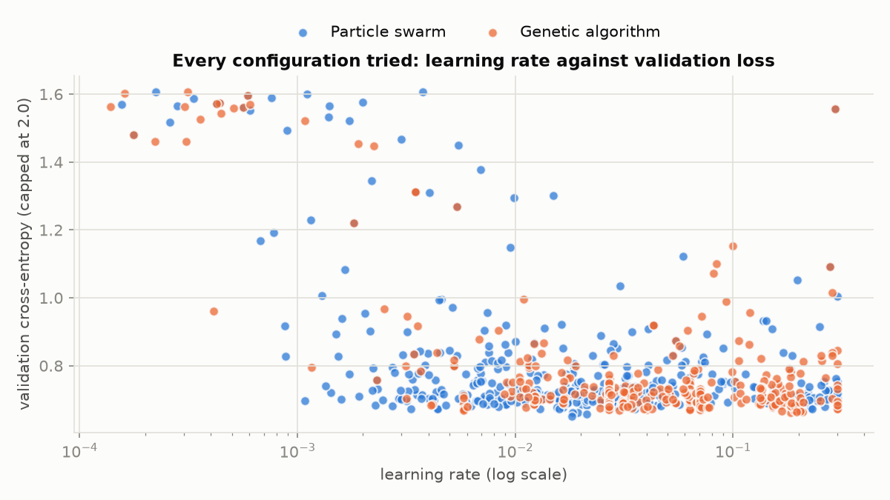

# Hyperparameter search: particle swarm vs genetic algorithm

Choosing a learning rate, a network size or a batch size by hand is slow, and training can get stuck in a poor
local minimum with a bad choice. `my_torch` searches them automatically with two metaheuristics, benchmarked here on
the chess dataset to pick the one we use.

1. [What is searched](#1-what-is-searched)
2. [How a configuration is scored](#2-how-a-configuration-is-scored)
3. [The two methods](#3-the-two-methods)
4. [Benchmark setup](#4-benchmark-setup)
5. [Results](#5-results)
6. [Selected method](#6-selected-method)
7. [Reproducing it](#7-reproducing-it)

## 1. What is searched

| Hyperparameter | Range | Scale | Why |
|---|---|---|---|
| `learning_rate` | 1e-4 to 0.3 | logarithmic | the step size of Momentum; useful values span several orders of magnitude |
| `momentum` | 0 to 0.99 | linear | how much of the previous step is kept |
| `batch_size` | 8 to 128 | logarithmic, whole | samples per gradient step |
| `hidden_size` | 16 to 256 | logarithmic, whole | neurons per hidden layer |
| `hidden_layers` | 1 to 3 | whole | ReLU layers before the softmax output |
| `decay` | 0.8 to 1 | linear | the learning rate is multiplied by it every epoch (1 keeps it) |

Every method works in the unit cube $`[0, 1]^6`$, one coordinate per hyperparameter, and `SearchSpace::decode` maps a
point to real values: $`low + u\,(high - low)`$ on a linear scale, the same between $`\log(low)`$ and $`\log(high)`$ on
a log scale, then rounding for whole values. On a log scale a learning rate is searched as evenly in 1e-4..1e-3 as
in 0.01..0.1. Code: `my_torch/src/training/hyperparameters/search_space/`.

## 2. How a configuration is scored

`ValidationLoss` builds the network the configuration describes (769 inputs, `hidden_layers` × `hidden_size` ReLU
layers, 5 softmax outputs), trains it on the training split with Momentum, cross-entropy and the exponential decay,
then returns its **cross-entropy on the validation split**, data it never trained on. Scoring on held-out data is
what keeps the search away from configurations that only memorize the training boards (overfitting). Every score
trains from the same seed, so two configurations are compared on equal terms. A training that diverges (NaN or
infinite loss) gets the worst possible score. Code: `my_torch/src/training/hyperparameters/validation_loss/`.

## 3. The two methods

Both minimize the same score over the same space and return every evaluation, so they are compared on the number
of networks trained. Code: `my_torch/src/training/hyperparameters/algorithms/`.

### Particle swarm optimization (PSO)

Each particle is a configuration with a position $`x`$ and a velocity $`v`$. It remembers the best position it has
found, $`p`$, and the swarm shares the best position anyone has found, $`g`$. At every iteration, for each
coordinate, with $`r_1, r_2`$ drawn uniformly in $`[0, 1]`$:

```math
v \leftarrow w\,v + c_1 r_1 (p - x) + c_2 r_2 (g - x), \qquad x \leftarrow x + v
```

| Setting | Value | Role |
|---|---|---|
| inertia $`w`$ | 0.7 | keeps part of the previous move: exploration |
| cognitive $`c_1`$ | 1.5 | pull towards the particle's own best |
| social $`c_2`$ | 1.5 | pull towards the swarm's best |
| max velocity | 0.2 | a particle never crosses more than 20 % of a range in one step |

A particle that hits a bound stays on it and loses its velocity along that coordinate.

### Genetic algorithm (GA)

A population of configurations evolves over generations. Each generation keeps its best individual unchanged (an
elite, not trained again), then fills the rest with children:

- **selection**: each parent is the best of 3 individuals drawn at random (tournament);
- **crossover** (90 % of children): each gene is drawn between and slightly beyond the parents' genes, $`a + u\,(b - a)`$
  with $`u`$ uniform in $`[-0.25, 1.25]`$ (blend crossover);
- **mutation**: each gene moves by a Gaussian step of standard deviation 0.1 with probability 0.2.

## 4. Benchmark setup

| | |
|---|---|
| Data | 7,500 positions from the Lichess database of January 2013, balanced over the 5 classes: 6,000 train, 750 validation, 750 test (`python -m dataset.generate ... --per-class 1500`) |
| Inputs | the analyzer's 769-input encoding (`analyzer.encoder.encode_fen`) |
| Training per evaluation | 6 epochs |
| Budget | PSO: 8 particles × 10 positions = **80** networks; GA: 8 individuals + 10 generations × 7 children = **78** networks |
| Repetitions | 5 seeds per method, all 10 searches run in parallel |
| Final check | the best configuration of each search is retrained and evaluated on the **test** split, never used by the search |

On the standard test functions of `my_torch/tests/training/hyperparameters/`, with about 3,000 evaluations, PSO
reaches Rosenbrock's minimum to within 0.00001 on every seed, while the GA stops between 0.0004 and 0.04: in the
valley, but slower to converge.

## 5. Results

| Method | Best validation loss | Test loss | Test accuracy | Networks trained to reach 0.678 | Minutes per search |
|---|---|---|---|---|---|
| Particle swarm | 0.667 ± 0.010 | **0.710 ± 0.001** | 68.3 ± 1.3 % | 35.4 ± 18.7 | **15.8 ± 6.0** |
| Genetic algorithm | 0.668 ± 0.003 | 0.711 ± 0.023 | 68.1 ± 1.4 % | 33.4 ± 12.0 | 21.5 ± 4.8 |

Mean ± standard deviation over 5 seeds. 0.678 is the worst final score of the 10 searches, a level every search
reaches, so the column measures how fast each one gets there. Guessing among the 5 classes would give 20 % accuracy
and a cross-entropy of $`\ln 5 \approx 1.61`$.

### Convergence



Both methods drop from about 1.5 to under 0.72 within the first 10 networks, then refine slowly. The medians stay
within 0.01 of each other the whole way: on this budget, neither converges clearly faster. The thin lines show the
spread between seeds; the best single run is a particle swarm one (0.652).

### Final results per seed


The two methods reach the same quality: the 0.001 gap in mean validation loss and the 0.2 point gap in test accuracy
are far smaller than the spread between seeds. The swarm is more spread on validation, from 0.652 to 0.678, but its
best configurations **generalize more evenly**: their test loss stays between 0.709 and 0.712, against 0.684 to 0.748
for the genetic algorithm.

### Where each method searched



The genetic algorithm concentrates quickly on learning rates between 0.005 and 0.3: selection keeps the good
individuals and crossover mixes them, so the population narrows down. The swarm keeps exploring more widely,
including rates below 1e-3, which all score badly in 6 epochs (top left, losses near $`\ln 5`$).

### Best configuration of each search

| Method | Seed | Validation loss | Test accuracy | Layers × neurons | Learning rate | Momentum | Batch | Decay |
|---|---|---|---|---|---|---|---|---|
| Particle swarm | 0 | 0.678 | 67.1 % | 2 × 141 | 0.028 | 0.66 | 42 | 0.89 |
| Particle swarm | 1 | 0.673 | 68.8 % | 2 × 54 | 0.0044 | 0.95 | 23 | 0.81 |
| Particle swarm | 2 | 0.663 | 67.5 % | 2 × 113 | 0.019 | 0.73 | 26 | 0.86 |
| Particle swarm | 3 | **0.652** | **70.3 %** | 2 × 47 | 0.018 | 0.53 | 9 | 0.86 |
| Particle swarm | 4 | 0.672 | 67.7 % | 2 × 46 | 0.23 | 0.29 | 118 | 0.82 |
| Genetic algorithm | 0 | 0.671 | 67.7 % | 2 × 167 | 0.063 | 0.63 | 64 | 0.88 |
| Genetic algorithm | 1 | 0.662 | 69.7 % | 1 × 128 | 0.18 | 0.67 | 87 | 0.90 |
| Genetic algorithm | 2 | 0.669 | 66.0 % | 3 × 87 | 0.030 | 0.19 | 23 | 0.93 |
| Genetic algorithm | 3 | 0.667 | 67.9 % | 2 × 191 | 0.0058 | 0.83 | 17 | 0.98 |
| Genetic algorithm | 4 | 0.669 | 68.9 % | 1 × 189 | 0.071 | 0.28 | 10 | 0.84 |

The swarm settled on **2 hidden layers** every time, with 80 neurons per layer on average; the genetic algorithm's
best networks are almost twice as wide (152 on average). That is why its searches took longer (21.5 against
15.8 minutes): it spent its budget training bigger networks for the same accuracy.

## 6. Selected method

**We use the particle swarm.**

On final quality the two methods tie: the differences are within the noise between seeds, so quality alone does not
decide. The swarm wins on everything around it:

- **cheaper results**: for the same accuracy it finds networks about half as wide, which train faster and make
  smaller `.nn` files, and its searches took 27 % less time;
- **more even generalization**: the test loss of its best configurations varies 20 times less between seeds
  (± 0.001 against ± 0.023);
- **better convergence when given time**: on Rosenbrock, with about 3,000 evaluations, it reaches the minimum on
  every seed (0.00001 or better) while the genetic algorithm stops between 0.0004 and 0.04 (section 4);
- **fewer settings to tune**: inertia, two pull weights and a speed cap, against population, elites, tournament
  size, crossover and mutation rates and mutation scale.

**Configuration retained** for the next training, the best of all 10 searches (particle swarm, seed 3): 2 hidden
layers of 47 ReLU neurons, learning rate 0.018, momentum 0.53, batch size 9, learning-rate decay 0.86 per epoch:
validation loss 0.652 and **70.3 % test accuracy after only 6 epochs**.

Limits of this benchmark: 6 epochs per evaluation and 7,500 positions keep a search under half an hour; the final
network will train longer on more data, so the search should be rerun at that scale with the swarm, starting from
this region of the space.

## 7. Reproducing it

```bash
python -m dataset.generate lichess_db_standard_rated_2013-01.pgn --out data --per-class 1500
scripts/run_hyperparameter_benchmark.sh data docs/benchmarks/hyperparameter_search 6 5
python -m scripts.plot_hyperparameter_search docs/benchmarks/hyperparameter_search docs/images
```

The first command builds the dataset, the second encodes it, builds the benchmark (`make -C my_torch benchmark`) and
runs the 10 searches, the third draws the figures of this page and prints the results table. The CSV logs of every
evaluation are in [`docs/benchmarks/hyperparameter_search/`](benchmarks/hyperparameter_search/).
