# my_torch: how the network works

The maths behind `my_torch`, written from scratch with numpy: the equations each class implements, the
shape of every matrix, the derivatives used to learn, and what training gives on real chess positions.
Every figure is drawn from the `my_torch` code itself by [`scripts/plot_docs.py`](../scripts/plot_docs.py).

1. [Notation and shapes](#1-notation-and-shapes)
2. [Architecture](#2-architecture)
3. [Forward pass](#3-forward-pass)
4. [Activations and their derivatives](#4-activations-and-their-derivatives)
5. [Softmax](#5-softmax)
6. [Loss functions](#6-loss-functions)
7. [Backpropagation](#7-backpropagation)
8. [Gradient check](#8-gradient-check)
9. [Weight initialization](#9-weight-initialization)
10. [Optimizers](#10-optimizers)
11. [Learning-rate schedules](#11-learning-rate-schedules)
12. [Training loop](#12-training-loop)
13. [Results](#13-results)
14. [Code map](#14-code-map)

## 1. Notation and shapes

Every value goes through the network as a **batch**: one sample per row.

| Symbol | Meaning | Shape |
|---|---|---|
| $`B`$ | batch size (number of boards processed together) | scalar |
| $`n_{in}`$, $`n_{out}`$ | inputs and outputs of a layer | scalars |
| $`C`$ | number of classes (5 for chess) | scalar |
| $`X`$ | layer inputs, one sample per row | $`(B, n_{in})`$ |
| $`W`$ | weights, **column $`j`$ belongs to neuron $`j`$** | $`(n_{in}, n_{out})`$ |
| $`b`$ | biases, one per neuron | $`(n_{out})`$ |
| $`Z = XW + b`$ | weighted sums, before the activation | $`(B, n_{out})`$ |
| $`A = f(Z)`$ | layer outputs, after the activation $`f`$ | $`(B, n_{out})`$ |
| $`P`$ | predictions of the last layer (probabilities) | $`(B, C)`$ |
| $`Y`$ | expected outputs, one-hot | $`(B, C)`$ |
| $`L`$ | loss, one number for the whole batch | scalar |
| $`\nabla_W L`$ | gradient of the loss with respect to $`W`$ | same shape as $`W`$ |
| $`\eta`$ | learning rate | scalar |
| $`\odot`$ | element-wise product | |

A gradient always has **the shape of what it is the gradient of**: $`\nabla_W L`$ is $`(n_{in}, n_{out})`$ like
$`W`$, $`\nabla_b L`$ is $`(n_{out})`$ like $`b`$. That rule is enough to check every equation below.

## 2. Architecture

The chess network turns a board into 769 numbers (12 piece types × 64 squares, plus whose turn it is) and gives
one probability per class:

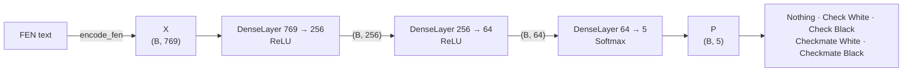

The module is built from small classes, each with a base class that fixes what every subclass must provide:

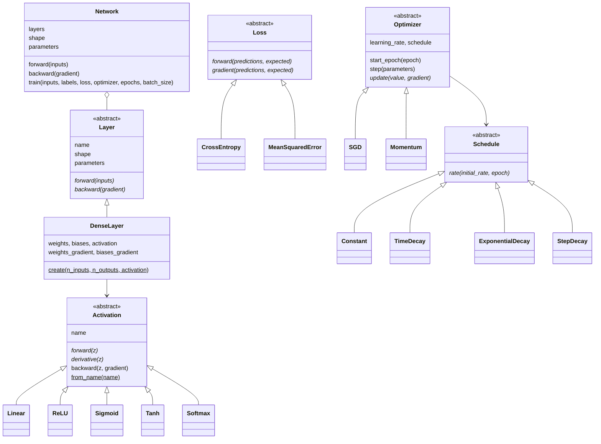

## 3. Forward pass

**One neuron** sums its inputs, each multiplied by a weight, adds a bias, then applies an activation:

```math
z = \sum_{i=1}^{n_{in}} x_i \, w_i + b \qquad a = f(z)
```

**A dense layer** is $`n_{out}`$ neurons reading the same inputs. Putting neuron $`j`$'s weights in column $`j`$
of $`W`$ turns the whole layer, for a whole batch, into one matrix product:

```math
\underbrace{Z}_{(B,\,n_{out})} = \underbrace{X}_{(B,\,n_{in})} \, \underbrace{W}_{(n_{in},\,n_{out})} + \underbrace{b}_{(n_{out})}
\qquad
A = f(Z)
```

$`b`$ is added to every row (numpy broadcasting). A single sample of shape $`(n_{in})`$ gives $`(n_{out})`$.

**A network** chains its layers, each reading the outputs of the previous one:

```math
A^{(0)} = X \qquad A^{(l)} = f^{(l)}\!\left(A^{(l-1)} W^{(l)} + b^{(l)}\right) \qquad P = A^{(\text{last})}
```

For the chain to work, layer $`l`$ must expect as many inputs as layer $`l-1`$ gives: `Network` checks it when it
is built (`layer 2 expects 32 inputs but receives 64`).

Each layer **keeps $`X`$ and $`Z`$** from its last forward pass: backpropagation needs both.

## 4. Activations and their derivatives

Without an activation, stacked layers collapse into one linear function
($`(XW_1)W_2 = X(W_1W_2)`$), however many there are. The activation adds the non-linearity that lets depth
learn rules like "the king is attacked **and** cannot escape".

Backpropagation needs each activation's **derivative** $`f'(z)`$: the slope of the curve, how much the output
moves when $`z`$ moves.

| Activation | $`f(z)`$ | $`f'(z)`$ | Range | Used for |
|---|---|---|---|---|
| `Linear` | $`z`$ | $`1`$ | $`\mathbb{R}`$ | regression outputs, tests |
| `ReLU` | $`\max(0, z)`$ | $`1`$ if $`z > 0`$, else $`0`$ | $`[0, +\infty)`$ | hidden layers |
| `Sigmoid` | $`\sigma(z) = \dfrac{1}{1 + e^{-z}}`$ | $`\sigma(z)\,(1 - \sigma(z))`$ | $`(0, 1)`$ | one yes/no probability |
| `Tanh` | $`\tanh(z)`$ | $`1 - \tanh^2(z)`$ | $`(-1, 1)`$ | hidden layers, centred on 0 |
| `Softmax` | $`p_i = \dfrac{e^{z_i}}{\sum_j e^{z_j}}`$ | a matrix per sample, see [§5](#5-softmax) | $`(0, 1)`$, sums to 1 | the output layer, one class among $`C`$ |

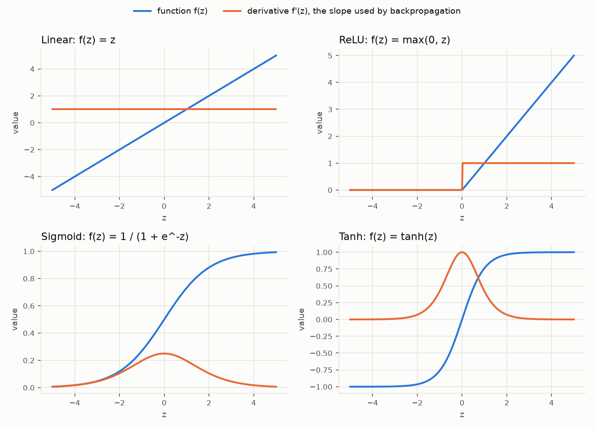

What the slopes show:

- **ReLU** passes the gradient through unchanged where $`z > 0`$ and blocks it where $`z \le 0`$. It never
  shrinks, which is why it trains deep networks well. At exactly $`z = 0`$ the code uses $`f'(0) = 0`$.
- **Sigmoid** has a slope of at most $`0.25`$, and **tanh** at most $`1`$, both close to $`0`$ for large $`|z|`$.
  Through many layers these small slopes multiply and the gradient fades: the *vanishing gradient* problem.
- **Overflow:** $`e^{-z}`$ overflows for $`z \approx -1000`$. `Sigmoid` uses the identical form
  $`\sigma(z) = \tfrac{1}{2}\left(1 + \tanh\tfrac{z}{2}\right)`$, which never overflows.

## 5. Softmax

Softmax turns $`C`$ scores into $`C`$ probabilities that sum to 1. Subtracting the row's maximum first keeps
$`e^{z}`$ from overflowing and changes nothing, since the factor $`e^{-\max z}`$ cancels:

```math
p_i = \frac{e^{z_i - \max_k z_k}}{\sum_j e^{z_j - \max_k z_k}}
```

**Its derivative is a matrix.** Raising one score lowers every other probability (they must still sum to 1), so
each output depends on every input. The Jacobian of one sample is $`C \times C`$:

```math
\frac{\partial p_i}{\partial z_j} = p_i \left(\delta_{ij} - p_j\right)
\qquad
J = \mathrm{diag}(p) - p\,p^\top
```

($`\delta_{ij} = 1`$ when $`i = j`$, else $`0`$.) The diagonal $`p_i(1 - p_i)`$ is positive: raising your own score
raises your probability. The rest, $`-p_i p_j`$, is negative.

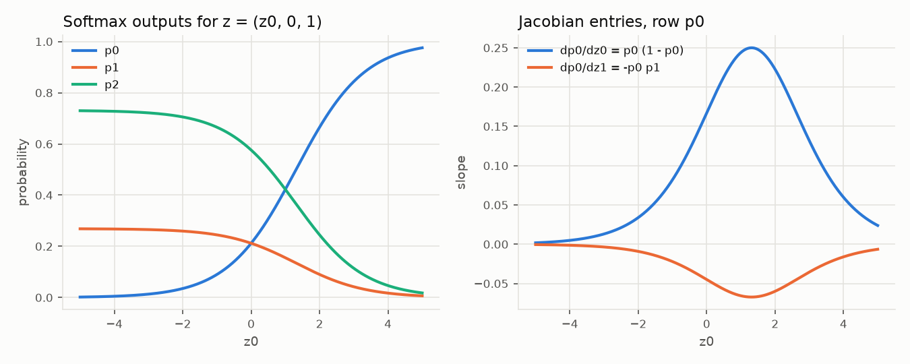

**Backward pass without building $`J`$.** Backpropagation needs $`J^\top g`$, where $`g = \partial L / \partial p`$.
Expanding the product gives a formula that never builds the $`C \times C`$ matrices:

```math
\frac{\partial L}{\partial z} = p \odot \left(g - \sum_k g_k\, p_k\right)
```

That is why `Softmax` overrides `backward`, while the other activations use the base class's
$`g \odot f'(z)`$ (their outputs depend on one input each, so their Jacobian is diagonal).

## 6. Loss functions

The loss is one number saying how wrong the predictions are, **averaged over the batch** so that it does not
grow with $`B`$. Training lowers it.

### Cross-entropy (classification)

```math
L = -\frac{1}{B} \sum_{b=1}^{B} \sum_{c=1}^{C} Y_{bc} \, \log \max\!\left(P_{bc}, \epsilon\right)
\qquad
\frac{\partial L}{\partial P_{bc}} = -\frac{Y_{bc}}{B \, \max(P_{bc}, \epsilon)}
```

With a one-hot $`Y`$, only the probability given to the **right** class counts: $`L = -\log p_{right}`$ for one
sample. $`\epsilon`$ (`1e-12` by default, a parameter of `CrossEntropy`) keeps $`\log 0`$ out: a confident wrong
answer gives a large loss, not infinity.

| Right class probability | 1.0 | 0.9 | 0.7 | 0.5 | 0.2 | 0.01 |
|---|---|---|---|---|---|---|
| Loss $`-\log p`$ | 0 | 0.11 | 0.36 | 0.69 | 1.61 | 4.61 |

### Mean squared error (regression, tests)

```math
L = \frac{1}{B\,C} \sum_{b,c} \left(P_{bc} - Y_{bc}\right)^2
\qquad
\frac{\partial L}{\partial P_{bc}} = \frac{2}{B\,C}\left(P_{bc} - Y_{bc}\right)
```

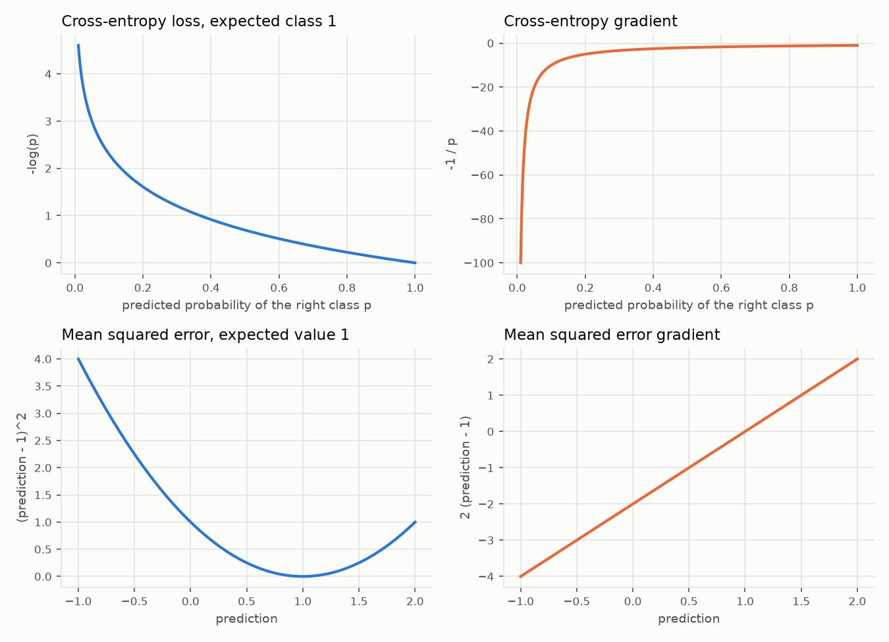

The cross-entropy gradient is very steep near $`p = 0`$: a confident mistake gets a strong correction. The
squared-error gradient is a straight line: it corrects in proportion to the error.

### Softmax + cross-entropy simplify

Chaining the cross-entropy gradient through the softmax backward pass:

```math
\frac{\partial L}{\partial z} = p \odot \Big(g - \sum_k g_k p_k\Big),
\quad g_k = -\frac{y_k}{B\,p_k}
\;\Rightarrow\;
\sum_k g_k p_k = -\frac{1}{B}\sum_k y_k = -\frac{1}{B}
\;\Rightarrow\;
\frac{\partial L}{\partial z} = \frac{P - Y}{B}
```

The gradient on the scores is simply **prediction minus expected**. The code does not special-case it: the
general formulas produce it, and a test checks that they do.

## 7. Backpropagation

Backpropagation computes $`\nabla_W L`$ and $`\nabla_b L`$ for every layer with the **chain rule**: walk the network
backwards, each layer turning "how the loss changes with my outputs" into "how it changes with my inputs".

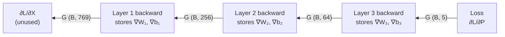

**One dense layer**, receiving $`G_A = \partial L / \partial A`$ of shape $`(B, n_{out})`$:

| Step | Equation | Shape |
|---|---|---|
| 1. Back through the activation | $`G_Z = G_A \odot f'(Z)`$ (softmax: [§5](#5-softmax)) | $`(B, n_{out})`$ |
| 2. Weight gradient | $`\nabla_W L = X^\top G_Z`$ | $`(n_{in}, B)(B, n_{out}) = (n_{in}, n_{out})`$ |
| 3. Bias gradient | $`\nabla_b L = \sum_{b=1}^{B} G_Z[b, :]`$ | $`(n_{out})`$ |
| 4. Gradient for the previous layer | $`G_X = G_Z\, W^\top`$ | $`(B, n_{out})(n_{out}, n_{in}) = (B, n_{in})`$ |

Why these products: $`Z_{bj} = \sum_i X_{bi} W_{ij} + b_j`$, so $`\partial Z_{bj} / \partial W_{ij} = X_{bi}`$ (summed over
the batch, that is $`X^\top G_Z`$), $`\partial Z_{bj} / \partial b_j = 1`$ (a sum over the batch), and
$`\partial Z_{bj} / \partial X_{bi} = W_{ij}`$ (that is $`G_Z W^\top`$). The shapes column checks each one.

`DenseLayer.backward` stores steps 2 and 3 as `weights_gradient` and `biases_gradient` and returns step 4.
`Network.backward` runs the layers in reverse. `backward` before `forward` is refused, since $`X`$ and $`Z`$
come from the forward pass.

## 8. Gradient check

A wrong gradient does not crash: training just quietly fails to learn. So every gradient is checked against a
**numerical** one, nudging each value by $`h = 10^{-6}`$ in both directions:

```math
\frac{\partial L}{\partial \theta} \approx \frac{L(\theta + h) - L(\theta - h)}{2h}
```

The tests compare, to a relative tolerance of $`10^{-4}`$ or better:

| What | Where |
|---|---|
| each loss gradient | `tests/my_torch/losses/test_loss.py` |
| each activation's derivative and backward, softmax's full Jacobian | `tests/my_torch/activations/test_activation.py` |
| each dense layer's weight, bias and input gradients, for all 5 activations | `tests/my_torch/layers/test_dense_layer.py` |
| **every weight, bias and input gradient of a whole 3-layer network**, with tanh/relu + softmax + cross-entropy and sigmoid + MSE | `tests/my_torch/network/test_gradient_check.py` |

## 9. Weight initialization

All-zero weights would give every neuron of a layer the same output and the same gradient: they would stay
identical forever. `DenseLayer.create` starts from random weights instead, scaled so that the values neither grow
nor shrink from layer to layer:

| Activation | Method | Weights drawn from |
|---|---|---|
| `ReLU` | He | $`\mathcal{N}\!\left(0,\ \sigma^2\right),\ \sigma = \sqrt{2 / n_{in}}`$ |
| anything else | Xavier (Glorot) | $`\mathcal{N}\!\left(0,\ \sigma^2\right),\ \sigma = \sqrt{2 / (n_{in} + n_{out})}`$ |

ReLU zeroes about half its inputs, so He doubles the variance to compensate. Biases start at $`0`$.

```python
DenseLayer.create(769, 256, ReLU())      # He: σ = √(2/769) ≈ 0.051
DenseLayer.create(256, 5, Softmax())     # Xavier: σ = √(2/261) ≈ 0.088
```

## 10. Optimizers

After `backward`, the optimizer moves every parameter $`\theta`$ (each $`W`$ and $`b`$) against its gradient.
`network.parameters` hands it `(value, gradient)` pairs and the update is done in place.

**SGD** (stochastic gradient descent):

```math
\theta \leftarrow \theta - \eta \, \nabla_\theta L
```

**Momentum** keeps a velocity $`v`$ per parameter (starting at $`0`$), so steps build up speed in a steady direction
and cancel out when the gradient zig-zags:

```math
v \leftarrow \mu\, v - \eta\, \nabla_\theta L
\qquad
\theta \leftarrow \theta + v
```

With a constant gradient the step tends to $`\eta / (1 - \mu)`$: **10 times** the SGD step for $`\mu = 0.9`$, so
momentum usually wants a smaller $`\eta`$. With $`\mu = 0`$ it is exactly SGD.

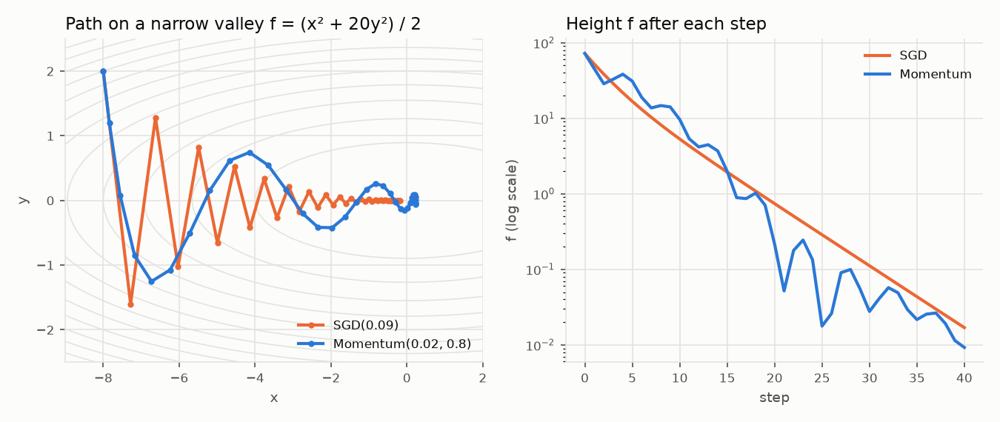

On a narrow valley, SGD with a large step bounces from side to side across it; momentum's velocity averages
those opposite pushes and moves along the valley.

## 11. Learning-rate schedules

A schedule changes $`\eta`$ from epoch to epoch: big steps early, when the weights are far from good, smaller
ones later, so they settle instead of jittering around the minimum. Starting from $`\eta_0`$, at epoch $`t`$:

| Schedule | $`\eta_t`$ | Parameters |
|---|---|---|
| `Constant()` | $`\eta_0`$ | |
| `TimeDecay(d)` | $`\dfrac{\eta_0}{1 + d\,t}`$ | $`d \ge 0`$ |
| `ExponentialDecay(γ)` | $`\eta_0\, \gamma^{t}`$ | $`0 < \gamma \le 1`$ |
| `StepDecay(γ, k)` | $`\eta_0\, \gamma^{\lfloor t / k \rfloor}`$ | $`0 < \gamma \le 1`$, $`k \ge 1`$ |

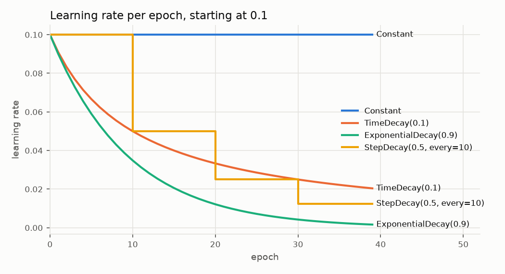

```python
optimizer = Momentum(learning_rate=0.01, momentum=0.9, schedule=StepDecay(0.5, every=8))
```

Momentum steadies the **direction** of the steps; a schedule shrinks their **size**. They are used together.

## 12. Training loop

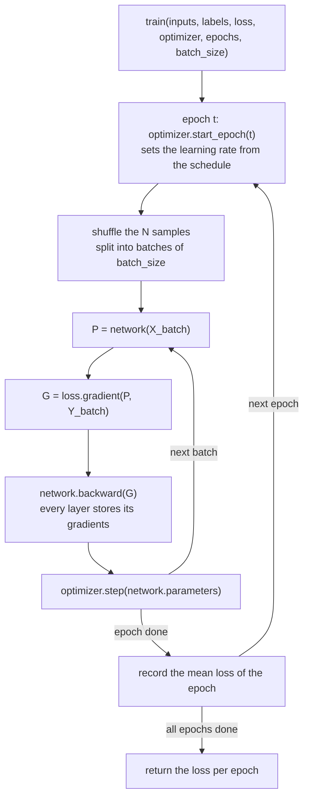

The loss of an epoch is the mean over every sample, each batch weighted by its size:

```math
\bar{L}_t = \frac{1}{N} \sum_{\text{batches } \mathcal{B}} |\mathcal{B}| \; L(\mathcal{B})
```

`batch_size = 1` is plain stochastic gradient descent, `batch_size = N` is full-batch gradient descent, anything
between is mini-batch. Shuffling every epoch keeps the batches from always grouping the same samples.

## 13. Results

### XOR

XOR cannot be separated by a single straight line, so learning it needs the hidden layer, the derivatives,
backpropagation and the optimizer all working together.

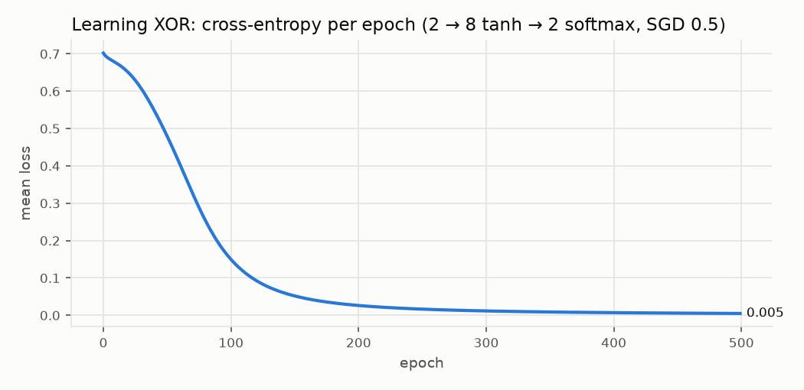

| Input | Expected | Network output $`P(1)`$ after 500 epochs |
|---|---|---|
| (0, 0) | 0 | 0.003 |
| (0, 1) | 1 | 0.995 |
| (1, 0) | 1 | 0.995 |
| (1, 1) | 0 | 0.007 |

It is learned from 5 different random starts (`tests/my_torch/network/test_xor.py`).

### Chess positions

Data: 121,332 games from the [Lichess database](https://database.lichess.org/) (January 2013), turned by
`python -m dataset.generate … --per-class 2000` into 8,000 training, 1,000 validation and 1,000 test positions,
**balanced over the 5 classes** (blind guessing scores 20%). Network 769 → 256 → 64 → 5 (ReLU, ReLU, softmax),
cross-entropy, batch size 32, same starting weights for every run.

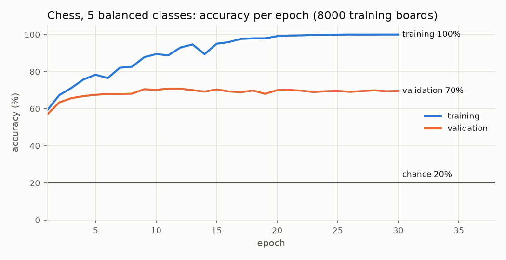

| Optimizer | Best validation accuracy | Test accuracy |
|---|---|---|
| `SGD(0.05)` | 70.8% (epoch 11) | 72.3% |
| `SGD(0.05)` + `StepDecay(0.5, every=8)` | 71.5% (epoch 11) | 72.6% |
| `Momentum(0.05, 0.9)` + `StepDecay(0.5, every=8)` | 70.1% (epoch 14) | 72.5% |
| `Momentum(0.01, 0.9)` + `StepDecay(0.5, every=8)` | **71.7%** (epoch 9) | **72.9%** |

- The network does learn the task: about **72%** on positions from games it never saw, against 20% for chance.
- Momentum learns faster in the first epochs; a schedule keeps the validation accuracy from sliding down later.
  The differences between optimizers are within the noise of a 1,000-position test set (about ±3%).
- **The limit is overfitting:** training accuracy reaches 100% while validation stalls around 70% from epoch 10.
  The network memorizes 8,000 positions instead of learning the rules of check. More data (20,000 per class)
  and the overfitting prevention of #13 (early stopping, dropout, L2) are the next levers.

To redraw every figure, including this one when a dataset is given:

```bash
python -m scripts.plot_docs data        # data/ holds train.txt and validation.txt from dataset.generate
```

## 14. Code map

| Concept | Equation | Code |
|---|---|---|
| Dense layer forward | $`Z = XW + b,\ A = f(Z)`$ | `my_torch/layers/dense_layer.py` · `DenseLayer.forward` |
| Network forward | $`A^{(l)} = f^{(l)}(A^{(l-1)}W^{(l)} + b^{(l)})`$ | `my_torch/network/network.py` · `Network.forward` |
| Activations, derivatives | §4 table | `my_torch/activations/activation.py` · `forward`, `derivative`, `backward` |
| Softmax backward | $`p \odot (g - \sum g_k p_k)`$ | `my_torch/activations/activation.py` · `Softmax.backward` |
| Losses and gradients | §6 | `my_torch/losses/loss.py` · `CrossEntropy`, `MeanSquaredError` |
| Layer backward | $`X^\top G_Z,\ \sum G_Z,\ G_Z W^\top`$ | `my_torch/layers/dense_layer.py` · `DenseLayer.backward` |
| Network backward | layers in reverse | `my_torch/network/network.py` · `Network.backward` |
| Initialization | He, Xavier | `my_torch/layers/dense_layer.py` · `DenseLayer.create` |
| SGD, momentum | §10 | `my_torch/optimizers/optimizer.py` · `SGD`, `Momentum` |
| Schedules | §11 table | `my_torch/optimizers/schedule.py` |
| Training loop | §12 | `my_torch/network/network.py` · `Network.train` |
| Gradient check | central difference | `tests/my_torch/network/test_gradient_check.py` |
