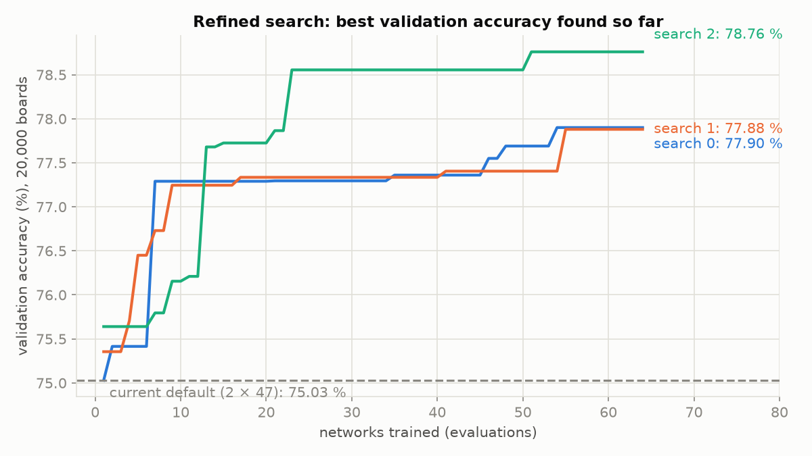
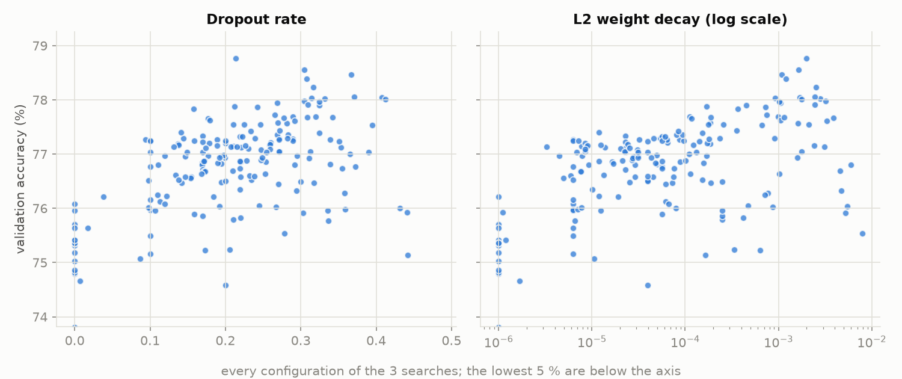

# Refined search: from the first search to the network we push

The [first hyperparameter search](hyperparameter_search.md) settled the method (particle swarm), the loss
(cross-entropy) and the hidden activation (ReLU), and retained a 2 × 47 network. But it ran at a small scale (6,000
boards, 6 epochs per network) and could not try dropout or L2. At full scale, the hand-written
`regularized_network.conf` then beat that network on every seed ([`benchmarks/final_network/`](benchmarks/final_network/)).
This second search closes that gap: it **learns from the first one** and **trains every candidate the way `--train`
does**, on far more boards.

1. [What changes from the first search](#1-what-changes-from-the-first-search)
2. [How it learns from the first search](#2-how-it-learns-from-the-first-search)
3. [How a configuration is scored](#3-how-a-configuration-is-scored)
4. [Setup](#4-setup)
5. [Results of the search](#5-results-of-the-search)
6. [Full-scale check](#6-full-scale-check)
7. [The network we push](#7-the-network-we-push)
8. [Limits](#8-limits)
9. [Reproducing it](#9-reproducing-it)

## 1. What changes from the first search

| | First search | Refined search |
|---|---|---|
| Method | particle swarm and genetic algorithm | **particle swarm only**, the method retained |
| Activation and loss | searched (ReLU / tanh, cross-entropy / MSE) | **fixed to ReLU + cross-entropy**, the pair retained |
| Training of a candidate | 6 epochs, then scored | **early stopping like `--train`**: 10 % of the training boards kept aside, stop after 5 epochs without progress, best weights kept |
| Regularisation | none | **dropout** (0 to 0.5, after every hidden layer) and **L2 weight decay** (1e-6 to 1e-2) |
| Ranges | wide, chosen by hand | **taken from the first search's best configurations** |
| Starting points | random | **the current default and the first search's best configurations** |
| Data | 6,000 training boards, 750 validation | **40,000 training boards** (a fixed sample of 160,000), **20,000 validation** |

The first search's main bias was scoring after a fixed 6 epochs: it rewarded configurations that learn **fast**
(high learning rate, batches of 9, a learning rate that decays quickly), not the ones that end **best** after a full
training, which is what `--train` does.

## 2. How it learns from the first search

- **Ranges:** of the 790 networks of the first search, the ReLU + cross-entropy ones in the best quarter give the range
  of each hyperparameter (their minimum and maximum, slightly widened, and always including the current default).
  The swarm does not waste networks on regions the first search already showed to be poor.
- **Starting points:** 4 of the 8 particles start from known configurations, the current default (2 × 47) and the
  3 best of the first search, with no dropout and almost no L2; the other 4 start at random in the new ranges.
- **New dimensions:** dropout and L2 come on top, so the swarm can test whether regularisation pays off at this scale.

The ranges each search used are logged in `refined_seed*_space.csv`.

## 3. How a configuration is scored

`FitScore` (`my_torch/src/training/hyperparameters/fit_score/`) builds the network (ReLU hidden layers, a dropout
layer after each when the rate is above 0, softmax output), trains it with the project's `Training::fit` (Momentum,
cross-entropy, exponential learning-rate decay, L2, early stopping with the best weights kept), then returns its error
on the 20,000 validation boards, which no network trains on. The score is therefore the one the analyzer's `--train`
would give, on a smaller training set.

## 4. Setup

| | |
|---|---|
| Data | `data/` regenerated from `lichess_db_standard_rated_2016-12.pgn` with `--per-class 40000 --seed 42`: 160,000 / 20,000 / 20,000 boards, balanced over the 5 classes |
| Training per candidate | 40,000 boards sampled once from `train.txt`, early stopping up to 20 epochs |
| Budget | 3 searches (seeds 0, 1, 2) in parallel, 8 particles × 8 positions = 64 networks each, 192 in all; each search trains 6 networks at once (20 cores shared by the 3 searches) |
| Output | logs and the best configuration of each search as a generator config, `refined_seed*_best.conf` |

## 5. Results of the search

| Search | Networks trained | Starting point (current default) | Best found | Minutes | Best configuration |
|---|---|---|---|---|---|
| 0 | 64 | 75.03 % | 77.90 % | 39 | 2 × 55, dropout 0.32, L2 4.5e-4, learning rate 0.055, momentum 0.37, × 0.89 per epoch, batches of 13 |
| 1 | 64 | 75.35 % | 77.88 % | 35 | 2 × 54, dropout 0.21, L2 1.7e-4, learning rate 0.077, momentum 0.44, × 0.83 per epoch, batches of 21 |
| 2 | 64 | 75.64 % | **78.76 %** | 116 | **2 × 256**, dropout 0.21, L2 2.0e-3, learning rate 0.0135, momentum 0.71, × 0.90 per epoch, batches of 15 |

Validation accuracy on the 20,000 validation boards, each network trained on 40,000 boards for at most 20 epochs
(lower than the full-scale figures of §6, which train on 160,000 boards: what counts here is the ranking).



All three searches beat the current default by 2.5 to 3 points, and they agree on what matters:

- **Regularisation is what the first search missed.** No network without dropout goes above 76 %; the best ones
  have a dropout of 0.2 to 0.35 and an L2 of 1e-4 to 3e-3. Above about 5e-3, L2 starts to cost accuracy again.
- **Two hidden layers** in every best configuration, and larger batches than the default's 9: 13 to 21. The
  learning rate and momentum vary from one search to the other (0.0135 to 0.077, 0.37 to 0.71): they go together,
  a smaller learning rate with a higher momentum.
- **Width is the open question.** Searches 0 and 1 settle around 2 × 55; search 2 goes to 2 × 256, the top of its
  range, with a stronger L2, and is best by almost a point. A wide network held back by dropout and L2 is the same
  idea as `regularized_network.conf` (128 + 64, dropout 0.2, L2 1e-4).



## 6. Full-scale check

The search ranks configurations on a reduced training; the network we push is trained with
`./my_torch_analyzer --train` on all 160,000 boards. `basic_network.conf` and `regularized_network.conf` were already
compared that way, 3 seeds each ([`benchmarks/final_network/`](benchmarks/final_network/)):

| Config | Epochs (kept / run) | Validation accuracy | Test accuracy | Minutes per training |
|---|---|---|---|---|
| `basic_network.conf` (2 × 47) | 10 / 15 | 82.2 to 82.5 % | 82.5 to 82.7 % | 4 to 4.5 |
| `regularized_network.conf` (128 + 64, dropout, L2) | 11 / 19 | 83.4 to 83.9 % | 83.9 to 84.1 % | 12 to 13 |

The best configuration of the search, `configs/refined/refined_seed2_best.conf` (2 × 256), is trained the same way
(`scripts/compare_final_networks.sh`) and judged on the same 20,000 validation boards; the 20,000 test boards are
only looked at to report. One full-scale training needs about 2.5 GB of memory, so the comparison was kept to the
one configuration that can change the decision.

*Pending: the training is running.*

## 7. The network we push

*Pending: chosen from the full-scale check.*

## 8. Limits

- **Reduced training in the search:** 40,000 boards and at most 20 epochs per network; the ranking can shift at full
  scale, which is why §6 retrains the best configuration with `--train`.
- **Search 2 stopped at the edge of its range** (256 neurons): a wider network might do better still, at a higher
  training cost.
- **One full-scale run** for the refined configuration against 3 for basic and regularized: differences under a few
  tenths of a point between them are within the spread of the seeds.

## 9. Reproducing it

```bash
python -m dataset.generate lichess_db_standard_rated_2016-12.pgn --out data --per-class 40000 --seed 42
scripts/run_refined_search.sh data docs/benchmarks/refined_search 40000 20 3
cp docs/benchmarks/refined_search/refined_seed*_best.conf configs/refined/
JOBS=3 scripts/compare_final_networks.sh data docs/benchmarks/refined_search/final_check 1 data/refined_check \
    configs/refined/refined_seed2_best.conf
python -m scripts.plot_refined_search
```
